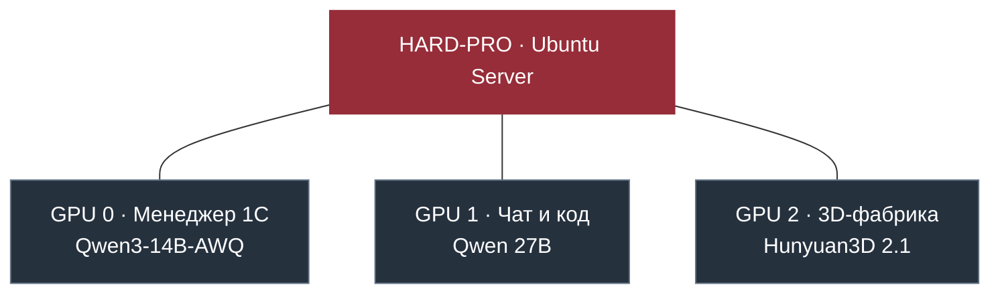

# HARD-PRO Corner

**Локальный ИИ для магазина спортивной экипировки.** Менеджер спрашивает в Open WebUI, сколько пар нужного размера свободно в каждом магазине. Покупатель на витрине собирает комплект по своим меркам. Здесь можно попробовать поиск на учебном каталоге, подключить свой сервер к 1С или сравнить скорость локальных моделей на RTX 3090.

[Попробовать каталог](#первый-запуск) · [Замеры на RTX 3090](#замеры-на-rtx-3090) · [Настроить сервер](docs/server-setup.md) · [Статус проекта](STATUS.md)

## Как чат отвечает на вопрос об остатках

> **Менеджер** — Сколько перчаток «Гранит» осталось?
>
> **Помощник** — Какой вес нужен — 12 или 14 oz?
>
> **Менеджер** — 14 oz. Посмотри оба склада.
>
> **Помощник** — На 19 ноября, 12:00 МСК, на складе «Север» свободны 3 пары, в «Центре» — 0.

Это учебный пример. Чтобы ответить, помощник находит конкретный вариант перчаток и вычитает резерв из остатка на каждом складе. Ноль означает, что свободных пар нет. Если в источнике отсутствует складская строка, количество неизвестно.

| Где задан вопрос | Откуда берётся ответ |
| --- | --- |
| **У менеджера в Open WebUI** | Каталог читает данные из 1С. Если база недоступна, чат показывает дату последнего сохранённого снимка. [Как устроен поиск](docs/catalog-assistant.md) |
| **В виджете на витрине** | Чат читает опубликованный каталог. С открытой карточки он получает товар, вариант и магазин уже для первого вопроса. [Как проверили карточку](docs/storefront-widget-cards-2026-11-25.md#контекст-открытой-карточки) |

Покупатель может поменять размер одной вещи, увидеть новую сумму и подтвердить комплект в корзине. Если нужен сотрудник, виджет показывает покупателю вопрос перед отправкой в MAX. В браузерном тесте вопрос дошёл до тестового получателя. [Подбор комплекта](docs/storefront-widget-cards-2026-11-25.md#подбор-комплекта-и-корзина) · [Передача вопроса в MAX](docs/storefront-widget-cards-2026-11-25.md#передача-вопроса-сотруднику-в-max)

## Первый запуск

Для знакомства с поиском достаточно Python 3 и файлов репозитория. Из корня проекта запустите тесты.

```sh
python -m unittest discover -s manager-demo -p test_archive_catalog.py -v
```

Три теста используют вымышленные товары и работают без GPU, модели и подключения к 1С. Они проверяют, например, что XL и 2XL различаются, уточнение «10 oz» сохраняется, а пропущенный остаток не превращается в ноль. В конце появится `OK`. Для запуска HTTP-виджета с собственным каталогом понадобятся дополнительные зависимости и адрес JSON-снимка. [Настройка публичного демо](manager-demo/README.md)

## Замеры на RTX 3090

На стенде HARD-PRO три RTX 3090 по 24 ГиБ. В обычном режиме у каждой своя задача. Для замеров Flash Next все три карты выделяли одной модели. [Конфигурация стенда](STATUS.md#проверка-28-ноября)



| Задача | Что получилось на стенде |
| --- | --- |
| **Qwen3.8 Flash Next на трёх GPU** | На коротком одиночном запросе перенос экспертов MoE из ОЗУ на GPU поднял медиану генерации с **46,50 до 72,03 токена/с**. По три прогона после прогрева. Отдельно испытали окна 16K, 64K и 128K. [Параметры llama.cpp и результаты](docs/three-3090-flash-next.md) |
| **Модель 27B для кода на одной RTX 3090** | С MTP скорость выросла с 38,5 до **70,2 токена/с** на коротком запросе и с 28,5 до **52,3** при входе в 62 тыс. токенов. [Сравнение режимов MTP](docs/llm-speed-27b.md) · [Тест на 102 тыс. токенов](docs/long-context-27b.md) |
| **Qwen3-14B-AWQ для менеджера** | Обе модели, 14B и 9B, прошли **17 из 17** архивных реплик. Для менеджера выбрали 14B после отдельной проверки ответов о неизвестном остатке. [Сравнение моделей](docs/catalog-assistant.md) · [Расход видеопамяти в vLLM](docs/tuning-manager-14b.md) |
| **Видео из фотографии** | Wan 2.2 TI2V-5B собрала ролик 1280 × 704 за **116,2 с** на одной карте — 49 кадров, 20 шагов. В отчёте есть и замеры FLUX.2 Klein 4B и Z-Image Turbo. [Настройки генерации медиа](docs/local-media.md) |

## Руководства по компонентам

- **Связать локальную LLM с 1С.** Права и варианты подключения к базе описаны в руководстве по MCP. В публичной копии есть примеры и инструкции. Для рабочего каталога отдельно нужны компоненты менеджера, настройки и данные. [MCP для 1С](onec-mcp/README.md) · [Проверка связи](docs/manager-link-recovery.md)
- **Задавать вопросы по документам, фото и видео.** В Open WebUI поиск по документам использует RAG, изображения и видео обрабатывает модель зрения, голос распознаёт faster-whisper. [Модели и проверки Open WebUI](docs/chat-model-stack.md) · [Фильтр вложений и инструменты Linux](local-llm/README.md)
- **Найти инструкцию по экипировке.** В пилоте сравнили поиск по словам и по смыслу на одном наборе вопросов. [Гибридный поиск в Qdrant](docs/knowledge-retrieval-pilot.md)
- **Управлять моделями и агентом.** В HARD-PRO Hub собраны доска моделей, шлюз локальной сети и диагностика запросов. Для работы с кодом есть отдельная конфигурация Open WebUI. [HARD-PRO Hub](hardpro-hub/README.md) · [Рабочее место разработчика](openwebui-coding/README.md)
- **Разобраться со службой после перезагрузки.** В руководствах собраны настройки автозапуска и разбор ошибок веб-чата. [Службы systemd](systemd/README.md) · [Диагностика Open WebUI](openwebui-errors-ru.md)

[Вся документация](docs/README.md) · [Правила публикации](AGENTS.md)
