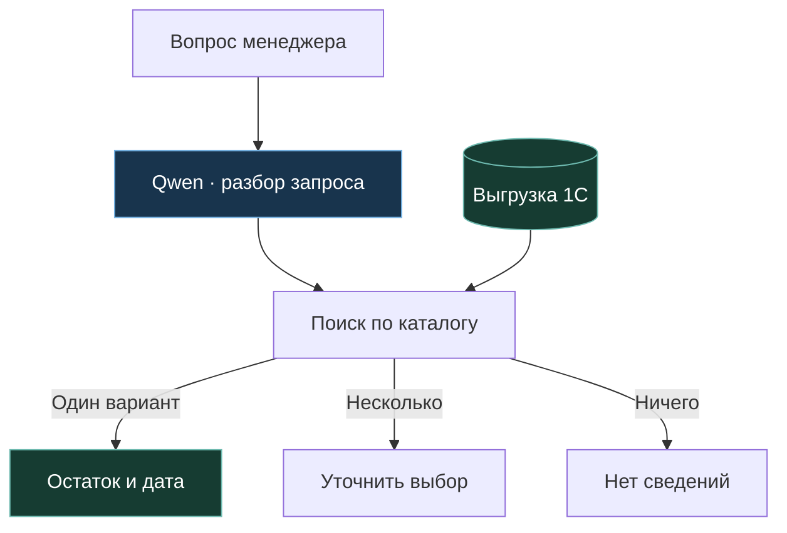

# HARD-PRO Corner

**Русскоязычный помощник по каталогу и остаткам 1С на одной RTX 3090.** Менеджер задаёт вопрос своими словами. Помощник находит товар и размер, уточняет выбор при нескольких совпадениях и показывает свободное количество по каждому складу на дату выгрузки.

[Попробовать помощника](#попробовать-помощника) · [Как устроен поиск](#как-устроен-поиск) · [Выбор модели](#выбор-модели) · [Фото, видео и код](#фото-видео-и-код-на-rtx-3090) · [Собрать сервер](#собрать-сервер) · [Проверить работу](#проверить-работу)

[Поиск и ответы менеджерского помощника](docs/manager-dialog.md)

## Попробовать помощника

Запустите диалог в консоли Ubuntu на сервере с установленным помощником.

```bash
hp-manager --onec
```

**Пример диалога на вымышленных данных**

> **Менеджер** · Сколько перчаток «Гранит» осталось?<br>
> **Помощник** · Какой вес нужен — 12 или 14 oz?<br>
> **Менеджер** · 14 oz. Посмотри оба склада.<br>
> **Помощник** · По учебной выгрузке от 19 ноября, 12:00 МСК. Север — 3 пары, Центр — 0.

Можно ответить размером или цветом, выбрать строку через `№2` и пролистать длинный список словом `ещё`. Вопрос «А в другом магазине?» продолжает текущий поиск. `/выход` завершает диалог. Для учебного каталога запустите `hp-manager` без аргументов.

Публичный репозиторий содержит руководство по сборке. Пример запроса к своему API и инструкции для чистой Ubuntu находятся в разделе [«Собрать сервер»](#собрать-сервер).

### Два чата в браузере

| Где открыть | Что можно спросить | Источник |
| --- | --- | --- |
| **Open WebUI · менеджер** | «Сколько перчаток 14 oz свободно на каждом складе?» | Выгрузка 1С с датой снимка. Отсутствующая строка склада означает, что количество неизвестно. |
| **Питомец HARD-PRO · покупатель** | «Что взять для бокса? Есть 12 oz? Как менялась цена?» | Опубликованные карточки, текущие остатки с учётом резервов и ежедневные наблюдения цены по вариантам. |

Open WebUI обращается к совместимому с OpenAI API каталога. Питомец справа открывает боковую панель на компьютере и полноэкранный чат на телефоне. История живёт в памяти страницы и очищается при обновлении или начале нового диалога. Покупательский чат формирует ответы по правилам из базы своей витрины. Количество возвращает тот же метод, что обслуживает карточку товара. Чат выдаёт ссылки на выбранный вариант, собирает комплект по виду спорта или списку вещей и показывает адрес и телефон магазина.

Названия и ссылки формируются из публичных записей. Свободный текст обрабатывается отдельно от заказов и аккаунтов. Типичные личные данные отсекаются в браузере и на сервере. Вопрос о травме ведёт к совету обратиться к врачу. Текст сообщений не сохраняется в журнале приложения.

История цены начинается с первого наблюдения. При одном значении помощник показывает дату и текущую цену. Для сравнения используются наблюдения за последние 90 дней. Зачёркнутая цена на карточке показывается отдельно.

**Как повторить проверку.** Откройте карточку товара и чат. Спросите о товаре без размера, выберите вариант во второй реплике и смените город в третьей. Сравните количество в ответе с тем же вариантом на странице. Фраза «Сколько всего товаров на сайте?» проверяет число карточек и активных вариантов. При сверке с 1С учитывайте дату выгрузки и резервы сайта.

Для личного теста Open WebUI работает в однопользовательском режиме через SSH. Виджет и vLLM слушают loopback. Веб-сервер стенда передаёт вопрос на Ubuntu по закрытому SSH-соединению, которое Ubuntu устанавливает сама. Второй канал возвращает доступные количества из базы витрины. Systemd поднимает службы при загрузке и восстанавливает туннель при обрыве. Рабочий компьютер можно выключить.

[Документация Open WebUI](https://docs.openwebui.com/)

### Переход с выгрузки на рабочий регистр 1С

На сервере «Розницы» выделяют служебную учётную запись с правами на внешнее соединение, чтение номенклатуры и остатков. Обработчик умеет читать страницы справочника и получать количество с резервом по идентификаторам конкретного товара и размера. Оба конца соединения проверяют сертификаты. Учётные данные 1С хранятся на сервере базы.

Прототип клиента на Ubuntu прошёл проверку с vLLM и учебным источником. Список вариантов кешируется на пять минут. При каждом ответе о количестве клиент заново читает выбранную характеристику и выводит момент чтения. Отсутствующая строка и явный ноль отображаются по-разному.

**Как проверить рабочее подключение.** Выберите один вариант с резервом и один со свободным нулём или пропущенной строкой. В менеджерском чате спросите про каждый из двух складов и сверьте ответ с регистром в тот же момент. После отключения источника свежие количества должны стать недоступны. До приёмки используется явно подписанный архивный режим.

## Как устроен поиск



| Что нужно выяснить | Откуда берётся ответ |
| --- | --- |
| Какой товар имелся в виду? | Модель извлекает условия запроса. Приложение ищет карточку и характеристику, сохраняя их идентификаторы. |
| Сколько можно предложить? | Приложение вычисляет **количество минус резерв** по строке одной характеристики на конкретном физическом складе. |
| Что означает пропуск? | Для варианта и склада в выгрузке нет строки. Наличие неизвестно. Ноль показывается при подтверждённом значении. |
| Можно ли обещать наличие сегодня? | Помощник указывает время снимка. Для подтверждения нужен свежий результат чтения 1С. |

Файлы модели лежат на отдельном NVMe 4 ТБ. При запуске vLLM загружает веса в видеопамять одной RTX 3090. Карта разбирает вопрос, а приложение на CPU находит складскую строку и подставляет количество. Для витрины можно использовать тот же движок с отдельным набором опубликованных товаров и полей.

## Выбор модели

Для каталога важно, умеет ли модель сохранить размер, цвет и склад во второй реплике. Для предварительного отбора использовали опубликованные тесты, для решения о запуске — одинаковые русскоязычные запросы на своей видеокарте.

| Модель | Опубликованный результат |
| --- | --- |
| Qwen3.5-9B | BFCL v4 **66,1**. [Карточка Qwen](https://huggingface.co/Qwen/Qwen3.5-9B) |
| Qwen3.5-4B | BFCL v4 **50,3** в той же таблице. [Карточка Qwen](https://huggingface.co/Qwen/Qwen3.5-9B) |
| Granite 4.2 8B | BFCL v4 **52,39** по данным IBM. [Карточка IBM](https://huggingface.co/ibm-granite/granite-4.2-8b) |
| Gemma 4 12B | **69,0%** на Tau2, отдельном тесте диалогов с инструментами. [Карточка Google](https://ai.google.dev/gemma/docs/core/model_card_4) |

BFCL оценивает работу с функциями. Для локального сравнения использованы Qwen3-14B-AWQ и сборка Qwen3.5-9B W4A16 от Red Hat. В W4A16 квантована часть линейных слоёв, формат весов — Safetensors. [Карточка сборки Red Hat](https://huggingface.co/RedHatAI/Qwen3.5-9B-quantized.w4a16)

### Что получилось на RTX 3090

| Проверка | Qwen3-14B-AWQ | Qwen3.5-9B W4A16 |
| --- | ---: | ---: |
| Контрольные реплики о каталоге, включая уточнения | 17 из 17 | 17 из 17 |
| Дополнительные карточки | 20 ответов, 4 уточнения | 20 ответов, 4 уточнения |
| Медиана ответа в диалоге с обращением к модели | 0,45 с | 0,50 с |

Обе модели работали по очереди под нагрузкой, каждая на отдельной RTX 3090, с контекстом 4 096 токенов, одним запросом за раз и отключённым режимом рассуждения. В замер входит разбор реплики моделью и поиск в открытом каталоге. Время запуска программы и загрузки весов в медиану не входит.

**Для менеджера выбрали Qwen3-14B-AWQ.** В дополнительном учебном вопросе без складской строки 14B сообщила, что остаток неизвестен. 9B в свободном ответе объявила товар отсутствующим. В режиме поиска по выгрузке этот ответ формирует приложение. Для покупателей потребуется отдельная проверка на ассортименте и данных витрины.

## Фото, видео и код на RTX 3090

В проекте две RTX 3090 по 24 ГиБ. Первая обслуживает каталог через vLLM. На второй запускаем ComfyUI для фото и роликов и llama.cpp для разработки. Задачи на этой карте выполняются по очереди. Веса и результаты хранятся на отдельном NVMe, вычисления идут на GPU.

| Задача | Модель | Зачем выбрали |
| --- | --- | --- |
| Фото из текста | **Z-Image Turbo 6B**, BF16 | Быстрая фотореалистичная генерация с коротким циклом денойзинга. Авторы указывают возможность запуска с 16 ГБ VRAM. Apache 2.0. [Карточка модели](https://huggingface.co/Tongyi-MAI/Z-Image-Turbo) |
| Фото из текста и редактирование | **FLUX.2 Klein 4B**, BF16 | Одна модель обрабатывает текст и референсы. Ориентир BFL — около 13 ГБ VRAM. Apache 2.0. [Сравнение BFL](https://help.bfl.ai/articles/6122710168-which-flux-2-model-should-i-choose) · [Веса и шаблоны ComfyUI](https://huggingface.co/Comfy-Org/Flux-2-Klein-4B) |
| Видео из фото или текста | **Wan 2.2 TI2V-5B**, FP16 | Штатный сценарий ComfyUI. Авторский запуск поддерживает 720p при 24 кадрах в секунду на GPU с 24 ГБ и выгрузкой в ОЗУ. Apache 2.0. [Репозиторий Wan](https://github.com/Wan-Video/Wan2.2) · [Веса ComfyUI](https://huggingface.co/Comfy-Org/Wan_2.2_ComfyUI_Repackaged) |
| Разработка и работа с инструментами | **Qwen3.8-27B**, GGUF UD-Q5_K_M | 19,87 ГБ на SSD. У исходной модели в отчёте Qwen — 73,0 на Terminal-Bench 2.1 с Terminus и 42,2 на DeepSWE 1.1. Эти цифры относятся к данным авторов и их условиям. [Карточка Qwen](https://huggingface.co/Qwen/Qwen3.8-27B) · [Квант Unsloth](https://huggingface.co/unsloth/Qwen3.8-27B-GGUF) |
| Эксперимент для разработки | **Huihui-Qwen3.8-27B-abliterated**, GGUF Q5_K | 19,54 ГБ на SSD. Производная с уменьшенной склонностью к отказам по описанию создателей. Запускается отдельно, чтобы сравнивать ответы на одинаковых задачах. [Карточка Huihui](https://huggingface.co/huihui-ai/Huihui-Qwen3.8-27B-abliterated-GGUF) |

### Что сравнивали

- **Изображения.** В ноябрьском рейтинге открытых весов лидируют MiniMax H3-Image, Qwen-Image-2.1 и FLUX 3 Image Klein. У первых двух свои условия. Для FLUX 3 Image Klein BFL указывает порог годовой выручки в $5 млн для бесплатного коммерческого применения. Для пилота взяли две модели с Apache 2.0 и штатными шаблонами. [Рейтинг Artificial Analysis](https://artificialanalysis.ai/image/leaderboard/text-to-image/open-weights) · [Условия FLUX 3 Image Klein](https://bfl.ai/blog/flux-3-image-klein)
- **Видео.** MiniMax H3 лидирует в рейтинге открытых весов I2V со звуком. На 24 ГБ руководство по интеграции предлагает отдельные компактные веса. У LTX-2.5 есть готовая INT8-сборка и совместная генерация звука и видео, а коммерческие условия зависят от выручки. Для первой установки выбрали Wan 2.2 с Apache 2.0 и штатным запуском на 24 ГБ. [Рейтинг I2V](https://artificialanalysis.ai/video/leaderboard/image-to-video/open-weights) · [Запуск H3](https://github.com/MiniMax-AI/awesome-minimax-h3-integration/blob/main/docs/run-h3-locally.md) · [Карточка LTX-2.5](https://huggingface.co/Lightricks/LTX-2.5)
- **Код.** Devstral Small 2 24B подходит для агентных задач на потребительской карте. Qwen3-Coder-Next 80B требует более плотной квантизации или выгрузки в ОЗУ при 48 ГиБ суммарной VRAM. Qwen3.8-27B позволяет оставить место под контекст на одной 3090 и проверить две версии одной основы. [Карточка Devstral](https://huggingface.co/mistralai/Devstral-Small-2-24B-Instruct-2512) · [Карточка Qwen3-Coder-Next](https://huggingface.co/Qwen/Qwen3-Coder-Next)

### Как повторить

1. Установи **ComfyUI v0.46.0** в отдельное окружение Python 3.12. Для RTX 3090 проверены PyTorch 2.9.1 и колёса CUDA 12.8. Открой шаблон нужной модели и разложи файлы из карточки по `models/diffusion_models`, `models/text_encoders` и `models/vae`. Z-Image Turbo и FLUX.2 Klein в сборках Comfy-Org используют один Qwen 3 4B энкодер. [Релиз ComfyUI](https://github.com/Comfy-Org/ComfyUI/releases/tag/v0.46.0) · [Z-Image Turbo для ComfyUI](https://huggingface.co/Comfy-Org/z_image_turbo)
2. Установи **llama.cpp** и сохрани оба GGUF в отдельном каталоге на SSD. Для начала используй 16 384 токена контекста, одну модель в VRAM и один запрос одновременно. Для выбора запрошенной модели используй имя из `GET /v1/models`. [Руководство по серверу llama.cpp](https://llama.app/docs/serve)
3. Запусти оба интерфейса с привязкой к `127.0.0.1` и открой их через SSH. В примере используется профиль `llm-lab` из раздела о подключении.

```bash
ssh -N -L 18188:127.0.0.1:8188 -L 18081:127.0.0.1:8081 llm-lab
```

ComfyUI доступен на `http://127.0.0.1:18188/`, браузерный интерфейс llama.cpp — на `http://127.0.0.1:18081/`, его OpenAI-совместимый API — на `http://127.0.0.1:18081/v1`. Перед сменой типа тяжёлой нагрузки дождись завершения очереди и выгрузи предыдущую модель из видеопамяти.

### Проверка 20 ноября 2026 года

Проверили SHA-256 всех десяти файлов моделей. Они занимают 86,33 ГБ на NVMe. На RTX 3090 прошли BF16-вычисления в PyTorch. Интерфейсы ComfyUI и llama.cpp ответили через SSH. vLLM обслуживал каталог на второй карте во время измерений.

| Тест на одной RTX 3090 | Условия | Результат |
| --- | --- | --- |
| FLUX.2 Klein 4B из текста | 512×512, 4 шага | PNG за 4,1 с |
| FLUX.2 Klein 4B по референсу | 512×512, 4 шага | Замена фона за 4,1 с с сохранением формы и ракурса товара |
| Z-Image Turbo из текста | 512×512, 9 шагов | PNG за 6,1 с |
| Wan 2.2 из фото | 384×256, 33 кадра, 14 шагов | MP4 за 10,1 с |
| Wan 2.2 из фото | 1280×704, 49 кадров, 20 шагов | MP4 за 116,2 с |
| Wan 2.2 из текста | 512×320, 33 кадра, 14 шагов | MP4 за 12,2 с |
| Qwen3.8-27B UD-Q5_K_M | 16 384 токена контекста, один слот | Функция Python и вызов учебного инструмента прошли проверку. Около 38 токенов/с на коротком ответе |
| Huihui Qwen3.8-27B Q5_K | 16 384 токена контекста, один слот | Те же проверки пройдены. Около 39 токенов/с на коротком ответе |

Для ComfyUI замеряли время от отправки задания до готового файла. Видео проверили декодированием, оба режима вывели 24 кадра в секунду. У Qwen сравнили структурный результат и вызов инструмента на одинаковых коротких задачах. Контекст 16 384 — настройка пилота. Эти замеры показывают локальный запуск, а качество работы с большим репозиторием требует отдельного набора задач.

При обрыве скачивания загрузчик начинает следующую попытку с уже записанного объёма. Файл получает конечное имя после сверки размера и SHA-256. Этот сценарий проверили на тестовом обрыве соединения. Для обоих интерфейсов включён автозапуск через пользовательские службы systemd.

## Собрать сервер

Проверенная конфигурация пилота — Ubuntu Server 24.04 LTS, Python 3.12, vLLM 0.34.0, две установленные RTX 3090 по 24 ГиБ. Один экземпляр модели работает на одной карте. Начните с диска и SSH, затем переходите к модели и API.

<details>
<summary><strong>Диски · увидеть оба NVMe и смонтировать /srv/models</strong></summary>

`Usage of /` в приветствии Ubuntu относится к корневой файловой системе. Второй SSD становится доступен приложениям как каталог после монтирования. Посмотри источники обеих точек монтирования следующими командами.

```bash
lsblk -o NAME,MODEL,SIZE,FSTYPE,MOUNTPOINTS
findmnt --mountpoint /srv/models
df -hT / /srv/models
```

Для диска моделей использована файловая система ext4. При подготовке пустого SSD сначала сверь его модель, ёмкость, серийный номер и источник `/`. Форматирование уничтожает прежнее содержимое. В `/etc/fstab` укажи UUID уже созданной файловой системы. Имена устройств вида `nvme1n1` могут меняться между загрузками.

```fstab
UUID=<UUID_ФАЙЛОВОЙ_СИСТЕМЫ> /srv/models ext4 defaults,nofail,nodev,nosuid,x-systemd.device-timeout=10s 0 2
```

После `sudo mount /srv/models` проверь `findmnt` и создай на этом томе каталог `weights` и каталоги кеша с правами нужного пользователя. Для Hugging Face задай `HF_HOME=/srv/models/huggingface`, для PyTorch Hub — `TORCH_HOME=/srv/models/torch`. Если используется Ollama, укажи `OLLAMA_MODELS=/srv/models/ollama` в его systemd-службе и дай доступ к каталогу пользователю службы. После переноса сравни список моделей. Для сервиса инференса условие `ConditionPathIsMountPoint=/srv/models` защищает корневой диск от записи весов при отсутствии второго SSD. [Переменные Hugging Face Hub](https://huggingface.co/docs/huggingface_hub/package_reference/environment_variables)

</details>

<details>
<summary><strong>Подключение · настроить SSH-ключ в Windows Terminal и UFW</strong></summary>

Чтобы Windows OpenSSH применял выделенный ключ по короткому имени, добавь профиль в пользовательский `.ssh/config`. Пример использует вымышленное DNS-имя. Подставь свою учётную запись и путь к закрытому ключу.

```sshconfig
Host llm-lab
    HostName llm.example.invalid
    User operator
    IdentityFile ~/.ssh/llm_lab_ed25519
    IdentitiesOnly yes
```

`ssh llm-lab` откроет сервер. При `Permission denied (publickey)` выполни `ssh -G llm-lab` и проверь `identityfile`, затем `ssh -v llm-lab` покажет предлагаемый ключ. На сервере в `authorized_keys` должна быть соответствующая открытая часть. При первом соединении сверь отпечаток ключа **сервера** через доверенный канал.

Перед отключением парольного входа оставь рабочее SSH-окно открытым, проверь ключ во втором окне и разреши в UFW входящий TCP-порт SSH со своей административной сети. Параметры OpenSSH для этой схемы — `PubkeyAuthentication yes`, `PasswordAuthentication no`, `KbdInteractiveAuthentication no`, `PermitRootLogin no`. Выполни `sudo sshd -t`, проверь эффективные настройки через `sudo sshd -T`, перезагрузи конфигурацию `sudo systemctl reload ssh` и повтори вход в новом окне. `sudo ufw status verbose` покажет действующие правила. [OpenSSH в Ubuntu](https://documentation.ubuntu.com/server/how-to/security/openssh-server/) · [UFW в Ubuntu](https://documentation.ubuntu.com/server/how-to/security/firewalls/)

</details>

<details>
<summary><strong>Консоль · добавить температуры CPU, GPU и SSD в tmux</strong></summary>

`btop` показывает нагрузку на CPU, память и процессы. В `nvtop` удобно видеть использование каждой карты, VRAM и процессы GPU. Для обычной работы достаточно нижней строки tmux с температурой CPU, обеих GPU и NVMe. Она обновляется каждые две секунды и оставляет командную строку свободной. [Руководство tmux](https://github.com/tmux/tmux/wiki/Getting-Started) · [Проект nvtop](https://github.com/Syllo/nvtop)

```bash
sudo apt-get update
sudo apt-get install tmux btop nvtop lm-sensors ripgrep fzf bat bash-completion
sensors
nvidia-smi --query-gpu=index,name,pci.bus_id,temperature.gpu --format=csv
```

Минимальный пример для AMD CPU и NVMe. Сохрани его в `~/.local/bin/hp-temps` и выполни `chmod +x ~/.local/bin/hp-temps`. На Intel имя драйвера датчиков обычно `coretemp`. Если датчик недоступен, проверь `sensors` и содержимое `/sys/class/hwmon`.

```sh
#!/bin/sh
for sensor in /sys/class/hwmon/hwmon*; do
    [ -r "$sensor/name" ] && [ -r "$sensor/temp1_input" ] || continue
    case "$(cat "$sensor/name")" in
        k10temp|coretemp) label=CPU ;;
        nvme) label=$(awk '{print $1}' "$sensor/device/model") ;;
        *) continue ;;
    esac
    awk -v label="$label" '{printf "%s %.0f°C  ", label, $1/1000}' "$sensor/temp1_input"
done
timeout 2 nvidia-smi --query-gpu=index,temperature.gpu --format=csv,noheader,nounits 2>/dev/null |
    awk -F ', *' '{printf "GPU%s %s°C  ", $1, $2}'
printf '\n'
```

Добавь в `~/.tmux.conf` и запусти `tmux`. Чтобы применить изменения в открытой сессии, выполни `tmux source-file ~/.tmux.conf`.

```tmux
set -g mouse off
set -g status 2
set -g status-interval 2
set -g 'status-format[1]' '#[align=left,fg=colour117,bold] #($HOME/.local/bin/hp-temps)'
```

При подключении из Windows Terminal параметр `mouse off` оставляет выделение и правый клик самому терминалу. Для вставки текста из буфера Windows используй `Ctrl+Shift+V`. В уже открытой сессии достаточно выполнить `tmux set -g mouse off`. [Сочетания клавиш Windows Terminal](https://learn.microsoft.com/en-us/windows/terminal/customize-settings/actions#paste)

Для автозапуска добавь в конец `~/.profile` следующий блок. Условие проверяет интерактивную оболочку и терминал. Скрипты, `scp` и команды вида `ssh сервер команда` смогут использовать обычный текстовый поток.

```sh
case $- in
    *i*)
        if [ -t 0 ] && [ -t 1 ] && [ -z "${TMUX:-}" ] &&
           [ -n "${TERM:-}" ] && [ "$TERM" != dumb ] && command -v tmux >/dev/null; then
            exec tmux new-session
        fi
        ;;
esac
```

Для полноэкранного наблюдения подойдёт `watch -n 2 ~/.local/bin/hp-temps`. `Ctrl+C` вернёт приглашение. По умолчанию `Ctrl+B`, затем `D` отсоединяет сессию tmux. `tmux ls` показывает сохранённые сессии, `tmux attach -t ИМЯ` возвращает нужную. Для разработки `rg` ищет по коду, `fzf` помогает искать команды в истории после подключения Bash key bindings, а команда `batcat` подсвечивает исходники в Ubuntu.

</details>

<details>
<summary><strong>Движок · установить vLLM и оформить запуск через systemd</strong></summary>

Для первой карты нужны рабочий драйвер NVIDIA, поддерживаемая версия Python и совместимая пара PyTorch/vLLM. На минимальной Ubuntu для сборки модулей Triton пригодятся `build-essential` и `python3-dev`. Проверяй совместимость для конкретного релиза. Для фиксации карты получи UUID через `nvidia-smi -L` и задай `CUDA_VISIBLE_DEVICES` локально, особенно если в машине стоят две одинаковые по названию карты. [Установка vLLM на GPU](https://docs.vllm.ai/en/stable/getting_started/installation/gpu/)

Проверенный набор версий для Python 3.12 можно установить в отдельное окружение с помощью `uv`. В команде ниже используется публичный индекс PyPI. При скачивании через зеркало проверяй SHA-256 файлов по опубликованным хешам PyPI.

```bash
sudo apt-get install --no-install-recommends build-essential python3-dev
uv venv --python /usr/bin/python3 ~/.local/share/vllm-venv
uv pip install --python ~/.local/share/vllm-venv/bin/python 'vllm==0.34.0'
uv pip check --python ~/.local/share/vllm-venv/bin/python
. ~/.local/share/vllm-venv/bin/activate
```

Для пробы одной карты укажи свой GPU и расположение файлов. В интерактивной оболочке задай `export CUDA_VISIBLE_DEVICES='<UUID выбранной GPU>'`, `export HF_HOME=/srv/models/huggingface` и `export TORCH_HOME=/srv/models/torch`. В службе systemd перенеси эти переменные в `Environment=`. Если весовые файлы и токенизатор уже скачаны, `HF_HUB_OFFLINE=1` позволяет загружать их локально. [Установка uv](https://docs.astral.sh/uv/getting-started/installation/)

Пример запуска после загрузки совместимой модели в формате Hugging Face. Подставь каталог модели и передай случайный `VLLM_API_KEY` через закрытый файл окружения службы с правами `0600`. В примере контекст ограничен 4096 токенами и одним одновременным запросом. Доступный размер модели и KV-кеша нужно измерить на выбранных весах.

```bash
mountpoint -q /srv/models || exit 1
: "${VLLM_API_KEY:?Задай ключ API в закрытом окружении}"
export VLLM_API_KEY
vllm serve /srv/models/weights/MODEL_DIR --served-model-name manager \
  --host 127.0.0.1 --port 8000 --tensor-parallel-size 1 \
  --max-model-len 4096 --max-num-seqs 1 --gpu-memory-utilization 0.85
```

### Запуск через systemd

Создай `~/.config/llm-lab` с правами `0700`. Сгенерируй ключ один раз. `set -C` в примере защищает существующий файл от перезаписи, а `umask 077` ограничивает доступ владельцем.

```bash
install -d -m 700 ~/.config/llm-lab
(umask 077; set -C; python3 -c 'import secrets; print("VLLM_API_KEY=" + secrets.token_hex(32))' > ~/.config/llm-lab/api.env)
```

Сохрани пример как `~/.config/systemd/user/llm-lab.service`. Замени `MODEL_DIR` и значение `CUDA_VISIBLE_DEVICES` своими. В обычном unit-файле systemd спецификатор `%h` раскрывается в домашний каталог пользователя.

```ini
[Unit]
Description=Локальный API vLLM
ConditionPathIsMountPoint=/srv/models

[Service]
EnvironmentFile=%h/.config/llm-lab/api.env
Environment=CUDA_VISIBLE_DEVICES=GPU-UUID_ВЫБРАННОЙ_КАРТЫ
Environment=HF_HOME=/srv/models/huggingface
Environment=TORCH_HOME=/srv/models/torch
Environment=HF_HUB_OFFLINE=1
Environment=VLLM_HOST_IP=127.0.0.1
UMask=0077
NoNewPrivileges=yes
KillMode=mixed
ExecStart=%h/.local/share/vllm-venv/bin/vllm serve /srv/models/weights/MODEL_DIR --served-model-name manager --host 127.0.0.1 --port 8000 --tensor-parallel-size 1 --max-model-len 4096 --max-num-seqs 1 --gpu-memory-utilization 0.85

[Install]
WantedBy=default.target
```

Когда модель скачана, выполни `systemctl --user daemon-reload`, затем `systemctl --user start llm-lab`. Журнал доступен через `journalctl --user -u llm-lab -f`. Для постоянного запуска после выхода из консоли администратор может включить `loginctl enable-linger` для пользователя службы. Для старта службы при загрузке выполни `systemctl --user enable llm-lab`.

Для обращения с рабочей станции открой `ssh -N -L 8000:127.0.0.1:8000 llm-lab`. Клиент сможет использовать `http://127.0.0.1:8000/v1` и ключ приложения. Проверка после запуска — запрос к `/v1/models` с ключом и без него, затем короткая генерация. Для сквозной проверки базы мы создали на SSD миниатюрную Llama со случайными весами. Сервис вернул `401` без ключа и при неверном ключе, `200` со списком моделей и `200` с одним сгенерированным токеном через `/v1/chat/completions`. Этот тест проверяет загрузку с диска, вычисления на GPU и работу API. Контрольный запрос приведён в примере с учебным каталогом.

Ключ vLLM защищает маршруты инференса, поэтому адрес прослушивания и правила сети важны и при включённой авторизации. [Безопасность vLLM](https://docs.vllm.ai/en/stable/usage/security/)

</details>

<details>
<summary><strong>Учебный запуск · скачать Qwen3-14B-AWQ и послать первый запрос</strong></summary>

Для первого текстового прогона выбрана **Qwen3-14B-AWQ**. Команда Qwen выпускает готовую четырёхбитную версию с лицензией Apache 2.0. Два файла весов занимают 9,29 ГиБ на диске. Такая модель помещается на одной RTX 3090 и оставляет часть 24 ГиБ VRAM для рабочего контекста. В пилоте использован контекст 4096 токенов и один одновременный запрос. [Карточка модели и режимы ответа](https://huggingface.co/Qwen/Qwen3-14B-AWQ)

В окружении с `huggingface_hub` скачай зафиксированный снимок на смонтированный диск. Проверка точки монтирования предотвращает запись весов на системный SSD при недоступности второго диска.

```bash
(
  set -e
  mountpoint -q /srv/models
  export HF_HOME=/srv/models/huggingface
  hf download Qwen/Qwen3-14B-AWQ \
    --revision 31c69efc29464b6bb0aee1398b5a7b50a99340c3 \
    --local-dir /srv/models/weights/Qwen3-14B-AWQ
)
```

В службе vLLM выше укажи `/srv/models/weights/Qwen3-14B-AWQ` вместо каталога-примера и оставь имя API-модели `manager`. Для обычных вопросов менеджера используется `enable_thinking=false`. Следующий пример обращается к своему локальному API. Перед запуском экспортируй `VLLM_API_KEY` из закрытого окружения службы. Текст примера и каталог вымышлены.

```python
import json
import os
import urllib.request

physical, reserved, requested = 8, 5, 4
available = physical - reserved
messages = [
    {"role": "system", "content": "Ответь менеджеру кратко по-русски по учебной сводке. "
     f"Перчатки «Гранит», 14 oz, склад Север. Свободно {available} пары, "
     f"запрошено {requested}, недостаёт {max(0, requested - available)}."},
    {"role": "user", "content": "Хватит ли четырёх пар со склада Север?"}
]
body = {"model": "manager", "messages": messages, "temperature": 0, "max_tokens": 160,
        "chat_template_kwargs": {"enable_thinking": False}}
req = urllib.request.Request(
    "http://127.0.0.1:8000/v1/chat/completions", data=json.dumps(body).encode(),
    headers={"Content-Type": "application/json", "Authorization": "Bearer " + os.environ["VLLM_API_KEY"]})
with urllib.request.urlopen(req, timeout=90) as response:
    print(json.load(response)["choices"][0]["message"]["content"])
```

</details>

<details>
<summary><strong>Обслуживание · установить обновления и проверить сервер после перезагрузки</strong></summary>

На Ubuntu Server с `unattended-upgrades` сначала обнови индексы APT и проверь план установки. Источники обновлений и разрешение на автоматическую перезагрузку определяются настройками APT. Перед работой по SSH проверь, что автоматическая перезагрузка отключена. [Документация Ubuntu по unattended-upgrades](https://ubuntu.com/server/docs/how-to/software/automatic-updates/)

```bash
sudo apt-get --error-on=any update
sudo unattended-upgrade -v --dry-run
```

После проверки запусти установку отдельной системной службой. Тогда разрыв SSH-соединения не прервёт обновление. По журналу можно проследить установку до завершения.

```bash
sudo systemd-run --unit=llm-security-update --no-block /usr/bin/unattended-upgrade -v
journalctl -u llm-security-update -f
```

После завершения открой **новое** SSH-соединение с рабочей станции. Проверь результат установки и состояние оборудования.

```bash
dpkg --audit
/usr/lib/update-notifier/apt-check 2>&1; echo
nvidia-smi --query-gpu=name,pci.bus_id,memory.total,driver_version --format=csv
findmnt --mountpoint /srv/models -o SOURCE,TARGET,FSTYPE,UUID
findmnt --fstab --mountpoint /srv/models -o SOURCE,TARGET,FSTYPE
if test -e /run/reboot-required; then cat /run/reboot-required /run/reboot-required.pkgs; fi
```

В выводе `apt-check` второе число показывает количество доступных обновлений безопасности. Сверь обе карты по адресам PCI и UUID смонтированной файловой системы с UUID в `fstab`. Если Ubuntu запросила перезагрузку, согласуй время остановки и повтори проверки после загрузки.

</details>

## Проверить работу

| Что проверить | Как проверить |
| --- | --- |
| Диск моделей | `findmnt --mountpoint /srv/models` и `df -h /srv/models` показывают отдельную файловую систему. |
| Видеокарта | `nvidia-smi -L` перечисляет карты. Во время запроса `nvidia-smi` показывает процесс и занятую видеопамять. |
| Поиск и уточнение | Спросите про один артикул с несколькими размерами. Выберите размер, затем смените склад отдельной репликой. |
| Числа в ответе | Сопоставьте карточку, характеристику и склад с исходной строкой регистра на тот же момент времени. |

<details>
<summary><strong>Как воспроизвести сверку с 1С</strong></summary>

Сохраните исходные ответы запроса к `РегистрНакопления.ТоварыНаСкладах.Остатки` вместе с временем чтения. В этой конфигурации свободное количество вычисляют по формуле `КоличествоОстаток − РезервОстаток` для одной характеристики на одном физическом складе.

1. Сверьте один размер на двух складах, затем спросите о каждом складе отдельно. Эталон вычисляйте из исходных ответов регистра до подготовки файла для модели.
2. Возьмите другой размер того же товара и проверьте уточнение во второй реплике. Включите одноимённые характеристики с разными идентификаторами.
3. Проверьте частичный резерв, полный резерв, пропущенную строку и неизвестный склад. Если в рабочей выборке все резервы нулевые, проверьте вычитание на вымышленных данных.
4. Спросите о наличии сегодня. При чтении архива ответ должен содержать время выгрузки.

Первый прогон охватывал три товара, шесть размеров и два склада. Все 12 значений совпали с исходными строками при обоих способах задать вопрос. Затем поиск подключили к полной сохранённой выгрузке.

</details>

<details>
<summary><strong>Что показал первый прогон на учебном каталоге</strong></summary>

Приложение вычисляет свободное количество по формуле `физически − резерв` для конкретного SKU и склада. Оно передаёт модели явный статус, когда замер старше пяти минут или в выборке нет складской строки. В первом прогоне Qwen дважды приняла отсутствие сведений за отсутствие товара. В настройку добавили явные статусы и правило сохранять размер и вес при поиске на другом складе.

| Вопрос менеджера | Ответ модели на тестовых данных |
| --- | --- |
| Сколько стоят «Гранит» 12 oz и сколько свободно в Центре? | «Пара «Гранит» 12 oz стоит 3 900 руб. В Центре свободно 5 пар.» |
| Где взять «Гранит» 14 oz, если в Центре нет свободных пар? | «На складе Центр свободно: 0 пар «Гранит» 14 oz. В наличии только на складе Север — свободно 3 пары.» |
| Можно подтвердить клиенту наличие «Вектора» размера L в Центре? | «Нет, подтвердить наличие рашгарда «Вектор» размера L на складе Центр нельзя — данные устарели. Нужна сверка.» |

После правок проверили десять заранее записанных вопросов, четыре дополнительные формулировки и диалог с уточнением. На этом наборе ответы совпали с учебным каталогом. Медиана полного ответа на десять отдельных вопросов после запуска модели составила 0,58 с при одном запросе за раз. Затем те же правила проверки применили к выгрузке магазина.

</details>

[Правила репозитория и публикации](AGENTS.md) · [К началу](#hard-pro-corner)
