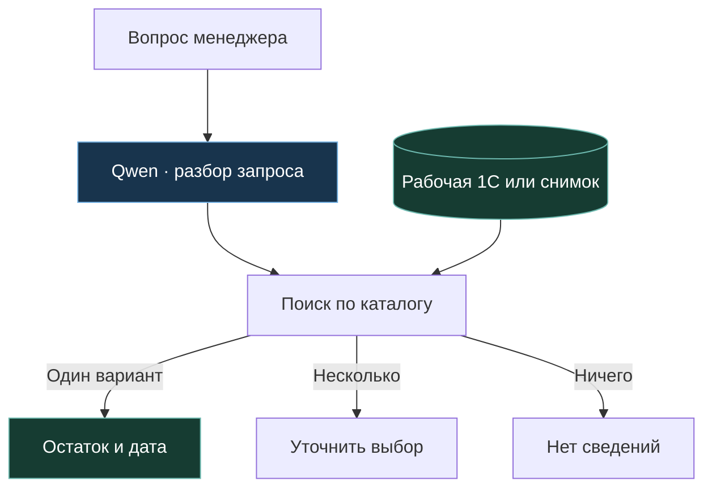

# Помощники по каталогу HARD-PRO

[Документация](README.md) · [Текущий статус](../STATUS.md)

## Попробовать помощника

Команды ниже относятся к Ubuntu с уже установленным менеджером. Публичная копия содержит описание и патч диалога, а установленные компоненты каталога и данные предоставляются отдельно.

```bash
hp-manager --onec
```

**Пример диалога на вымышленных данных**

> **Менеджер** · Сколько перчаток «Гранит» осталось?<br>
> **Помощник** · Какой вес нужен — 12 или 14 oz?<br>
> **Менеджер** · 14 oz. Посмотри оба склада.<br>
> **Помощник** · По учебной выгрузке от 19 ноября, 12:00 МСК. Север — 3 пары, Центр — 0.

Можно ответить размером или цветом, выбрать строку через `№2` и пролистать длинный список словом `ещё`. Вопрос «А в другом магазине?» продолжает текущий поиск. `/выход` завершает диалог. Для учебного каталога запустите `hp-manager` без аргументов.

Публичный репозиторий содержит руководство по сборке. Пример запроса к своему API и инструкции для чистой Ubuntu находятся в [руководстве по сборке](server-setup.md).

### Два чата в браузере

| Где открыть | Что можно спросить | Источник |
| --- | --- | --- |
| **Open WebUI · менеджер** | «Сколько перчаток 14 oz свободно на каждом складе?» | Рабочая 1С. При сбое используется последний доступный снимок с датой. |
| **Питомец HARD-PRO · покупатель** | «Что взять для бокса? Есть 12 oz? Как менялась цена?» | Опубликованные карточки, текущие остатки с учётом резервов и ежедневные наблюдения цены по вариантам. |

Open WebUI обращается к совместимому с OpenAI API каталога. Питомец справа открывает боковую панель на компьютере и полноэкранный чат на телефоне. История живёт в памяти страницы и очищается при обновлении или начале нового диалога. Покупательский чат формирует ответы по правилам из базы своей витрины. Количество возвращает тот же метод, что обслуживает карточку товара. Чат выдаёт ссылки на выбранный вариант, собирает комплект по виду спорта или списку вещей и показывает адрес и телефон магазина.

Названия и ссылки формируются из публичных записей. Свободный текст обрабатывается отдельно от заказов и аккаунтов. Типичные личные данные отсекаются в браузере и на сервере. Вопрос о травме ведёт к совету обратиться к врачу. Текст сообщений не сохраняется в журнале приложения.

История цены начинается с первого наблюдения. При одном значении помощник показывает дату и текущую цену. Для сравнения используются наблюдения за последние 90 дней. Зачёркнутая цена на карточке показывается отдельно.

**Как повторить проверку.** Откройте карточку товара и чат. Спросите о товаре без размера, выберите вариант во второй реплике и смените город в третьей. Сравните количество в ответе с тем же вариантом на странице. Фраза «Сколько всего товаров на сайте?» проверяет число карточек и активных вариантов. При сверке с 1С учитывайте дату выгрузки и резервы сайта.

Однопользовательский тест Open WebUI проводили через SSH. Для доступа по LAN см. [HARD-PRO Hub](../hardpro-hub/README.md). Виджет и vLLM слушают loopback. Веб-сервер стенда передаёт вопрос на Ubuntu по закрытому SSH-соединению, которое Ubuntu устанавливает сама. Второй канал возвращает доступные количества из базы витрины. Systemd поднимает службы при загрузке и восстанавливает туннель при обрыве. Рабочий компьютер можно выключить.

[Документация Open WebUI](https://docs.openwebui.com/)

### Чтение рабочего регистра 1С

На сервере «Розницы» выделяют служебную учётную запись с правами на внешнее соединение, чтение номенклатуры и остатков. Обработчик умеет читать страницы справочника и получать количество с резервом по идентификаторам конкретного товара и размера. Оба конца соединения проверяют сертификаты. Учётные данные 1С хранятся на сервере базы.

Прототип клиента на Ubuntu прошёл проверку с vLLM и учебным источником. Список вариантов кешируется на пять минут. При каждом ответе о количестве клиент заново читает выбранную характеристику и выводит момент чтения. Отсутствующая строка и явный ноль отображаются по-разному.

**Как проверить рабочее подключение.** Выберите один вариант с резервом и один со свободным нулём или пропущенной строкой. В менеджерском чате спросите про каждый из двух складов и сверьте ответ с регистром в тот же момент. После отключения источника свежие количества должны стать недоступны. При сбое источник переключается на подписанный снимок, если он сохранён. [Проверки и восстановление канала](manager-link-recovery.md).

## Как устроен поиск



| Что нужно выяснить | Откуда берётся ответ |
| --- | --- |
| Какой товар имелся в виду? | Модель извлекает условия запроса. Приложение ищет карточку и характеристику, сохраняя их идентификаторы. |
| Сколько можно предложить? | Приложение вычисляет **количество минус резерв** по строке одной характеристики на конкретном физическом складе. |
| Что означает пропуск? | Для варианта и склада в источнике нет строки. Наличие неизвестно. Ноль показывается при подтверждённом значении. |
| Можно ли обещать наличие сегодня? | При чтении снимка помощник указывает его дату. Подтверждение требует свежего чтения 1С. |

Файлы модели лежат на отдельном NVMe 4 ТБ. При запуске vLLM загружает веса в видеопамять одной RTX 3090. Карта разбирает вопрос, а приложение на CPU находит складскую строку и подставляет количество. Для витрины можно использовать тот же движок с отдельным набором опубликованных товаров и полей.

## Выбор модели

Для каталога важно, умеет ли модель сохранить размер, цвет и склад во второй реплике. Для предварительного отбора использовали опубликованные тесты, для решения о запуске — одинаковые русскоязычные запросы на своей видеокарте.

| Модель | Опубликованный результат |
| --- | --- |
| Qwen3.5-9B | BFCL v4 **66,1**. [Карточка Qwen](https://huggingface.co/Qwen/Qwen3.5-9B) |
| Qwen3.5-4B | BFCL v4 **50,3** в той же таблице. [Карточка Qwen](https://huggingface.co/Qwen/Qwen3.5-9B) |
| Granite 4.2 8B | BFCL v4 **52,39** по данным IBM. [Карточка IBM](https://huggingface.co/ibm-granite/granite-4.2-8b) |
| Gemma 4 12B | **69,0%** на Tau2, отдельном тесте диалогов с инструментами. [Карточка Google](https://ai.google.dev/gemma/docs/core/model_card_4) |

BFCL оценивает работу с функциями. Для локального сравнения использованы Qwen3-14B-AWQ и сборка Qwen3.5-9B W4A16 от Red Hat. В W4A16 квантована часть линейных слоёв, формат весов — Safetensors. [Карточка сборки Red Hat](https://huggingface.co/RedHatAI/Qwen3.5-9B-quantized.w4a16)

### Что получилось на RTX 3090

| Проверка | Qwen3-14B-AWQ | Qwen3.5-9B W4A16 |
| --- | ---: | ---: |
| Контрольные реплики о каталоге, включая уточнения | 17 из 17 | 17 из 17 |
| Дополнительные карточки | 20 ответов, 4 уточнения | 20 ответов, 4 уточнения |
| Медиана ответа в диалоге с обращением к модели | 0,45 с | 0,50 с |

Обе модели работали по очереди под нагрузкой, каждая на отдельной RTX 3090, с контекстом 4 096 токенов, одним запросом за раз и отключённым режимом рассуждения. В замер входит разбор реплики моделью и поиск в открытом каталоге. Время запуска программы и загрузки весов в медиану не входит.

**Для менеджера выбрали Qwen3-14B-AWQ.** В дополнительном учебном вопросе без складской строки 14B сообщила, что остаток неизвестен. 9B в свободном ответе объявила товар отсутствующим. В режиме поиска по выгрузке этот ответ формирует приложение. Для покупателей потребуется отдельная проверка на ассортименте и данных витрины.

## Проверить работу

| Что проверить | Как проверить |
| --- | --- |
| Диск моделей | `findmnt --mountpoint /srv/models` и `df -h /srv/models` показывают отдельную файловую систему. |
| Видеокарта | `nvidia-smi -L` перечисляет карты. Во время запроса `nvidia-smi` показывает процесс и занятую видеопамять. |
| Поиск и уточнение | Спросите про один артикул с несколькими размерами. Выберите размер, затем смените склад отдельной репликой. |
| Числа в ответе | Сопоставьте карточку, характеристику и склад с исходной строкой регистра на тот же момент времени. |

<details>
<summary><strong>Как воспроизвести сверку с 1С</strong></summary>

Сохраните исходные ответы запроса к `РегистрНакопления.ТоварыНаСкладах.Остатки` вместе с временем чтения. В этой конфигурации свободное количество вычисляют по формуле `КоличествоОстаток − РезервОстаток` для одной характеристики на одном физическом складе.

1. Сверьте один размер на двух складах, затем спросите о каждом складе отдельно. Эталон вычисляйте из исходных ответов регистра до подготовки файла для модели.
2. Возьмите другой размер того же товара и проверьте уточнение во второй реплике. Включите одноимённые характеристики с разными идентификаторами.
3. Проверьте частичный резерв, полный резерв, пропущенную строку и неизвестный склад. Если в рабочей выборке все резервы нулевые, проверьте вычитание на вымышленных данных.
4. Спросите о наличии сегодня. При чтении архива ответ должен содержать время выгрузки.

Первый прогон охватывал три товара, шесть размеров и два склада. Все 12 значений совпали с исходными строками при обоих способах задать вопрос. Затем поиск подключили к полной сохранённой выгрузке.

</details>

<details>
<summary><strong>Что показал первый прогон на учебном каталоге</strong></summary>

Приложение вычисляет свободное количество по формуле `физически − резерв` для конкретного SKU и склада. Оно передаёт модели явный статус, когда замер старше пяти минут или в выборке нет складской строки. В первом прогоне Qwen дважды приняла отсутствие сведений за отсутствие товара. В настройку добавили явные статусы и правило сохранять размер и вес при поиске на другом складе.

| Вопрос менеджера | Ответ модели на тестовых данных |
| --- | --- |
| Сколько стоят «Гранит» 12 oz и сколько свободно в Центре? | «Пара «Гранит» 12 oz стоит 3 900 руб. В Центре свободно 5 пар.» |
| Где взять «Гранит» 14 oz, если в Центре нет свободных пар? | «На складе Центр свободно: 0 пар «Гранит» 14 oz. В наличии только на складе Север — свободно 3 пары.» |
| Можно подтвердить клиенту наличие «Вектора» размера L в Центре? | «Нет, подтвердить наличие рашгарда «Вектор» размера L на складе Центр нельзя — данные устарели. Нужна сверка.» |

После правок проверили десять заранее записанных вопросов, четыре дополнительные формулировки и диалог с уточнением. На этом наборе ответы совпали с учебным каталогом. Медиана полного ответа на десять отдельных вопросов после запуска модели составила 0,58 с при одном запросе за раз. Затем те же правила проверки применили к выгрузке магазина.

</details>
